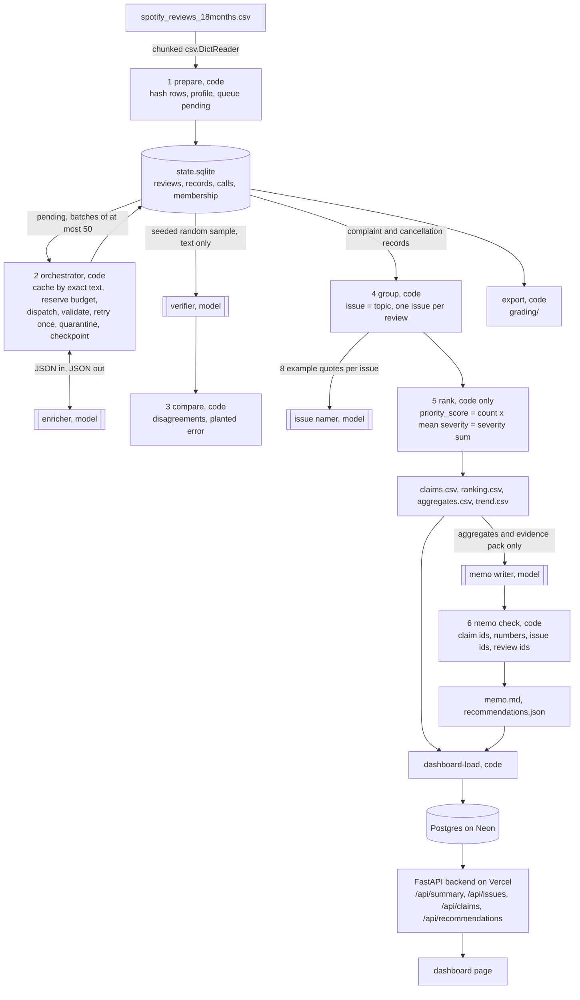

# Multi-Agent Insight Pipeline over Spotify Reviews

I built this for Assignment 5, the capstone of Fundamentals of Agentic AI. It is a Python program, `pipeline`, that takes the course's CSV of 660,622 Spotify app store reviews and turns it into a ranked list of product issues and a decision memo whose every number traces back to a saved calculation. Four bounded model roles (an enricher, a verifier, an issue namer, and a memo writer) do the language work, and deterministic code does everything else: ingestion, hashing, batching, validation, caching, budget control, resume, grouping, ranking, the citation checks on the memo, the grading export, and a dashboard that serves the saved results out of a database. The brief is in [ASSIGNMENT.md](ASSIGNMENT.md) and the plain-language walkthrough of the code is in [EXPLAINER.md](EXPLAINER.md).

## Where this stands right now

The full corpus has been run. On 2026-10-21 the pipeline classified all 660,622 review ids with Claude Haiku 5.5 at low effort and thinking turned off, 660,144 of them completed and 478 quarantined with a reason, for $30.07 of API spend against a $100 cap. The course's `check_submission.py` runs clean on the export except for one expected flag, `unfinished_classification: 465`, which is the count of nonempty reviews the model failed on twice and that I quarantined with their reasons. The dashboard is live at [spotify-insight-dashboard-xi.vercel.app](https://spotify-insight-dashboard-xi.vercel.app), reading the full run out of a Neon Postgres database. The real 100-review cold and warm pilot, the 500 and 10,000 checkpoints, the 1,000-review verifier sample, the golden 50, the injection test on the real model, and a terminal recording of a real interrupted and resumed run are all done and their files are in `cost/`, `evals/`, and `results/`.

One thing is not in the tree. The full `grading/` folder is 166 MB, so it is attached to the GitHub release [assignment-05-grading-2026-10-21](https://github.com/IsaacAVazquez/Fundamentals-of-Agentic-AI/releases/tag/assignment-05-grading-2026-10-21) as `grading-full.zip` instead of being committed, next to `enriched.jsonl.gz`, the 660,144 completed records on their own (95 MB); the small files from it (`run.json`, `ingestion.json`, `ranking.csv`, `claims.csv`, `claims_context.csv`, `checkpoint_before.json`) and the checker's report are in `results/full/`, along with `quarantine.jsonl`, the 478 quarantined records with their reasons and attempt counts.

Everything in `results/synthetic-demo/` and `results/cost-synthetic/` is from the zero-cost fake backend on templated reviews and says nothing about Spotify. I kept those folders because they are what the tests exercise and they show the machinery without a key.

## Where to find each requirement

| Requirement | Where it is |
| --- | --- |
| Distinct enrichment, verification, grouping, and memo roles coordinated by code | Architecture, and `insight_pipeline/prompts.py`, `classify.py`, `verify.py`, `group.py`, `memo.py` |
| Ingestion report and full run over every review id | `results/full/ingestion_report.json`, `results/full/run_summary.json`, and the release asset |
| Shared topic and severity definitions with examples, output schema, prompts | Labels and rubric, and `insight_pipeline/config.py`, `prompts.py` |
| Hand-labeled golden 50, evaluation results, inspected failures | Evaluations; `evals/golden_50.csv` and the scores, verifier, and planted-error results in `results/full/evals/` |
| Enriched table, quarantine log, membership, aggregates, ranking, memo | `results/full/quarantine.jsonl`, `enriched.jsonl.gz` on the release, and the rest in `results/full/` and `grading-full.zip` |
| Run evidence: models, prompt versions, tokens, cost, runtime, retries, failures, resume recording | `results/full/run_summary.json`, `run_log.jsonl`, and `calls.jsonl` plus the two checkpoint snapshots in the release asset; the recorded interruption and resume is `results/resume-recording/` |
| 100-review calculator with real pilot, editable prices, offline replay | Cost calculator, and `cost/` |
| Saved program that takes a CSV path; ranking regenerated without model calls | Running it: `pipeline run --input ...` and `pipeline rank`; `results/full/evals/reproducibility.json` |
| Deployed dashboard with backend and database | Dashboard, live at the URL above |
| Grading export and the checker | Grading export and the checker; `results/full/self-check.json` |
| Architecture diagram, one traced review, one failed case | Architecture, One review traced through |
| Baseline formula, tie-break, trend denominators, scope and limitations | Ranking, and Limitations |

## Setup

Everything runs from `assignment-05/`. The pipeline itself needs only the Python standard library (3.11 or newer). The optional pieces are the `anthropic` SDK for the Claude backend, `fastapi` and `psycopg` for the dashboard, and `pytest` for the tests.

```
git clone https://github.com/IsaacAVazquez/Fundamentals-of-Agentic-AI.git
cd Fundamentals-of-Agentic-AI/assignment-05
scripts/setup.sh                 # uv venv on Python 3.13, installs `pipeline` with the anthropic, dashboard, and test extras
cp .env.example .env             # fill in ANTHROPIC_API_KEY (and ANTHROPIC_WORKSPACE_ID for a user-scoped key) and DATABASE_URL
mkdir -p data && unzip ~/Downloads/"Final Assignment - Spotify Reviews Dataset.zip" -d data/
.venv/bin/pytest -q              # 26 tests on a synthetic file, no key needed, about two seconds
```

The dataset is not committed. Download it from the [Drive link in the brief](https://drive.google.com/file/d/1P0rUoAS_wVjp3BYKqXMEyD4u0uJP1Bvf/view), unzip it into `data/` (ignored by git), and `pipeline prepare` records the file's SHA-256 in `ingestion_report.json`. The ingestion report on the real file matched the manifest exactly: 660,622 rows, 13 empty texts, 159,701 missing app versions, 484,189 distinct nonempty texts, and no duplicate ids. `.gitignore` excludes `.env`, `.env.*`, `data/`, `runs/`, and `.vercel/`; `git check-ignore .env` prints `.env`.

One thing I learned the hard way about keys. A user-scoped Anthropic key (the `sk-ant-usr-` kind) is rejected unless every request carries an `anthropic-workspace-id` header, so the backend reads `ANTHROPIC_WORKSPACE_ID` from the environment and sends it when set. A workspace-scoped key needs nothing extra.

## Running it

The `pipeline` command has one subcommand per stage and `run` chains them. Commands that spend money are the ones that take `--backend anthropic` or `--backend openai`: `classify`, `verify`, `group --name`, `memo`, `run`, `cost pilot`, and `eval injection`. Everything else, including the default `cost replay`, `memo-check`, and `cost checkpoint`, is offline.

```
pipeline prepare --input data/spotify_reviews_18months.csv --run-dir runs/full      # stage 1, no model
pipeline classify --run-dir runs/full --backend anthropic --model claude-haiku-5-5 \
    --effort low --batch-size 25 --workers 20 --max-spend 100                       # stage 2, paid; Ctrl-C saves, rerun resumes
pipeline verify --run-dir runs/full --backend anthropic --sample 1000 --seed 20261020  # stage 3, paid
pipeline group --run-dir runs/full --backend anthropic --name                         # stage 4, membership by code, names by model
pipeline rank --run-dir runs/full                                                     # stage 5, no model
pipeline memo --run-dir runs/full --backend anthropic --model claude-sonnet-5-5       # stage 6, paid, then code checks
pipeline export --run-dir runs/full                                                   # writes runs/full/grading/
pipeline status --run-dir runs/full                                                   # counts, spend, phases
```

`pipeline run --input <csv> --run-dir <dir> --backend <b>` does all of that in order. `--max-batches`, `--max-reviews`, `--time-limit`, and `--max-spend` bound a run; `--limit` on `prepare` or `run` ingests only the first N rows. For a run on a sample file, `pipeline export --ingestion <profile.json>` takes the full-corpus profile written by `check_submission.py profile`, since the contract wants the full-file profile in every grading folder. `scripts/run_full.sh` is the sequence I ran, as one script. The fake backend is the default so that nothing is paid by accident:

```
python3 scripts/make_synthetic_reviews.py --out /tmp/syn.csv --rows 1000
pipeline run --input /tmp/syn.csv --run-dir runs/demo --backend fake --synthetic --workers 2
```

## Architecture



Each role has a fixed input, a fixed output schema, an owner, a failure behavior, and a stop rule. The enricher takes a JSON array of at most 50 `{id, text}` pairs and returns a JSON object with one record per id; invalid output is retried once and then quarantined with the reason; the stage stops when nothing is pending, when the spending cap would be exceeded by the next reservation, when a time or batch limit is reached, when the provider stays unavailable through the backoff, or on Ctrl-C, and in every case it saves first. The verifier takes text only, never the first label, and code compares. The issue namer takes a topic and eight example quotes with ids and returns a name and a one-sentence description; it cannot move a review. The memo writer takes the claims table, the ranked issues, a bounded evidence pack, and the scope, and returns markdown that code then checks. The orchestrator is a fixed sequence; the only place the next step depends on a model's output is the retry decision, and that decision is made by the validator in code.

Why each model call exists: the enricher reads messy language, which code cannot do with keyword rules at acceptable quality. The verifier is a second independent reading so the first one can be audited. The namer turns `ISS-billing` into a phrase a product manager would recognize, which is cosmetic and could be dropped. The memo writer turns a table into an argument, and because the table is the only numeric input and code checks every citation, the prose cannot introduce a number. Everything else, from the row hashes to the mean severity, is arithmetic and runs without a key.

## Labels and rubric

The eight topics are the brief's exact words, with the boundaries I wrote into the prompt: access (login, passwords, lockouts, verification codes), usability (controls, navigation, layout, ads getting in the way), playback (failures, crashes, freezes, lag, songs stopping), downloads (offline mode and saved music), catalog (availability, search, recommendations, lyrics, podcasts), billing (price, charges, refunds, paywalls, premium entitlement), support (contacting support, response time and quality), and other. The intent precedence is cancellation, complaint, request, praise, unclear, and severity is the brief's five-level scale judged on reported impact only, with examples per level in `config.py`. I put the decision rules from the brief's "apply common meanings" paragraph into the prompt verbatim, including that a paid-plan mention alone is not billing and that stars and angry language do not set severity.

On the full corpus the labels came out as 288,495 praise, 259,495 complaint, 65,073 unclear, 27,134 cancellation, and 19,947 request, and by topic 379,417 other, 84,770 usability, 67,676 catalog, 51,975 playback, 50,555 billing, 12,733 access, 11,400 downloads, and 1,618 support. The model set `needs_review` on 111,127 records, which is mostly the short and non-English reviews, and I left that flag in the data without filtering on it. The large `other` count is what I would expect from app store reviews, where "Good" and "Nice app" are a big share of the rows.

Three design choices I would defend. One issue per topic, with no model clustering, because the brief's ranking has to be reproducible by a spreadsheet, and any model-driven clustering would make membership depend on a nondeterministic step; the cost is that `ISS-playback` lumps crashes together with lag, which the namer's description and the evidence quotes partly recover. Batches of 25 rather than 50, because a malformed batch retries every record in it, so I would rather halve the blast radius than squeeze a little more prompt amortization; the cap of 50 is enforced regardless of the flag. Effort low on Haiku 5.5 with thinking turned off for the enricher, because it is a bounded form-filling task and the verifier sample exists to tell me if that was too cheap. The thinking setting was not a free choice. In my first paid pilot every batch came back truncated at the 4,000 output-token cap with 100 of 100 reviews quarantined for invalid JSON, because Haiku 5.5 thinks by default and those tokens count against `max_tokens`. Disabled thinking is supported on Haiku 5.5 at effort high or below, so the backend sends `thinking: {"type": "disabled"}` for Haiku models and the output cap is now 8,000. Sonnet 5.5, which writes the memo, rejects disabled thinking, so it keeps adaptive thinking at low effort.

Every completed record has `review_id`, `source_sha256`, `status`, `topic`, `intent`, `sentiment` (−1 to 1), `severity` (integer 1 to 5), `entities`, `evidence_quote` (an exact substring, checked in code), `needs_review`, and `label_config`, plus `cache_source_id` when it was copied from an identical text and `attempts`. `label_config` is `anthropic:claude-haiku-5-5|effort=low|prompt=v1|schema=v1`, and cache reuse requires an exact match on it, so a prompt edit invalidates the cache by construction. The row hash is the grading contract's: SHA-256 of the compact JSON list of the six source strings in order, which is byte for byte the `row_sha` helper in `check_submission.py`, and `tests/test_prepare.py` asserts that on the real `cost_100.csv` whenever the ZIP is unpacked.

## Orchestration controls

The spend ledger reserves a worst-case cost (estimated input tokens plus the output cap at the model's rates) before each batch is dispatched and refuses the dispatch when spent plus reserved plus the reservation would exceed `--max-spend`. Workers share that ledger under a lock, and only the main thread writes to SQLite, one transaction per batch, so two workers cannot double-count a review. Transient errors (429s, 5xx, timeouts) get up to six tries with exponential backoff and jitter, up to 30 seconds per wait, each try logged; if they all fail the rows stay pending and the run stops with `provider_unavailable`. Invalid output (bad JSON, a wrong id, a label outside the schema, a quote that is not a substring) gets exactly one retry at attempt 2 and then the row is quarantined with the reason. Every call, including failures, is logged with its provider request id, usage, and price, which is what `calls.jsonl` and the cost calculator read.

I built a fallback to Sonnet 5.5 for a capped fraction of retries and then turned it off for the real runs, because the grading contract checks that every successful enrichment call names the same `label_config` as the records it completed, and a record retried on a different model would fail that check for the first call that listed it. Retries run on the same model, and the full run shows that was enough: 481,991 reviews completed on attempt 1, 1,735 on attempt 2, and 465 were quarantined after two attempts, 434 of them because the model's evidence quote was not an exact substring of the review, 25 from one retried batch whose JSON came back cut off, and 6 because the model left the id out of its output.

Resume works because every row's status lives in the database and a new `classify` run simply takes what is pending. Each run records a phase (`initial` or `resume`) and writes checkpoint snapshots with the full list of completed ids. The full run went through six phases, which is more than I planned, and they are all in `results/full/run_summary.json`. The initial phase stopped after six batches on purpose, as the contract's interruption. The first resume ran 44 minutes on 16 workers with no rate-limit errors at about 70 calls a minute. I then tried 64 workers, which hit the account's token-per-minute limit within 72 seconds, 234 attempts came back 429, 77 batches gave up, and the run stopped itself with `provider_unavailable` after saving. At 32 workers it stayed up but took 236 more 429s in five minutes, with one minute of 128 successful calls and the rest between 64 and 89, so I settled on 20, which ran the remaining 3 hours 50 minutes with zero rate-limit errors. The last interruption was mine, because the exact-text cache lookup had slowed to five seconds per loop once there were hundreds of thousands of completed rows, because SQLite was scanning records by status, and after I made the query drive from the text-hash index the same 20 workers went from about 40 to between 100 and 120 successful calls a minute. All 470 failed attempts are in `calls.jsonl` with `outcome: "failed"` and the 429 text, and none of them cost anything or touched a record. The checker confirms the resume evidence, since the checkpoint taken before the first resume holds 150 completed ids, every one of them appears in a successful initial-phase call, and no resume-phase call ever carried one of them. Because that interruption happened hours before anyone could watch it, I also recorded one. `results/resume-recording/terminal.txt` is a `script` capture of `pipeline eval resume` on the real model over `cost_100.csv`, one worker, batches of 25. The initial phase stopped after two batches with 50 completed and 50 pending, the resume phase ran three more batches and ended with 99 completed and 1 quarantined, and none of the first 50 ids went out again. `resume_evidence.json` and the four checkpoint snapshots sit next to the capture, and the classify calls cost $0.006.

## Evaluations

The golden set procedure is the one the brief describes. `pipeline eval golden-template` writes a seeded sample with blank `human_*` columns, though on the real data the file to label is the ZIP's `golden_50_to_label.csv`, and `pipeline eval golden` compares the run's saved predictions against the human labels: topic and intent agreement, severity exact agreement and mean absolute error, sentiment mean absolute error against a predeclared tolerance of 0.5, exact-substring checks on the quotes, per-topic counts, a confusion table, and the number of cases marked ambiguous in the notes column. The golden labels never enter a prompt; the scorer only reads them. The labeled file is `evals/golden_50.csv`, with 14 of the 50 marked ambiguous in the notes column and the reason for each, and `results/full/evals/golden_results.json` holds the score against the full run. I should be plain about how those labels were made. The AI coding assistant I built this with drafted the first pass on 2026-10-21, after the full run had finished, because I could not get to my computer that night. I then went through all 50 myself against the contract's rules with the model's answers hidden, kept 46 as drafted, and changed four: a song that stops after a moment went from severity 3 to 4, the Swedish boycott review went from unclear to cancellation, the one-word Hindi insult on a 1-star review went from unclear to a severity 2 complaint, and "Unconditional love, Stoli Canales" went from unclear to praise. The copy I opened showed the model's answers before I hid them, so this was a review of a draft, which is weaker evidence than a blind pass, and two of my four changes moved toward the model's answer, so I would weigh those two less than the other two. The score was rerun after my changes. Of the 50, 49 compared and one, a feature request about organizing saved albums, was quarantined by the pipeline for a bad evidence quote and counts as missing. On the 49 the pipeline matched the golden topic for 89.8 percent (44 of 49), the intent for 91.84 percent (45), and the exact severity for 87.76 percent (43), with a severity mean absolute error of 0.1224, a sentiment mean absolute error of 0.0898 against the 0.5 tolerance, and no quote failures. The disagreements are in `golden_per_case.csv`. Three of the five topic misses sit on the usability and billing line, where the contract sends explicitly premium-only controls to billing and the model called one of those usability, it called a Duo Premium "no ads" review billing where the ads rule says usability, and it called a review that leads with price usability. All four intent misses are short or hostile reviews, where the model said unclear for the boycott, the Hindi insult, and "I hate this app and sweden" and read a Hindi plea about ads as a request where I read a complaint, and most of the six severity misses are one step apart on short complaints. The pattern I would pull out is that the model's topic errors cluster on the usability and billing boundary, which is also the boundary that decides the top of the ranking, and that is the first thing I would tighten in the prompt.

The verifier is where the real quality evidence is. On the full run it re-labeled a seeded sample of 1,000 directly classified records from the text alone, 998 of them compared and 2 failed validation, and it agreed with the enricher on topic for 86.07 percent, on intent for 92.38 percent, and on the exact severity for 89.68 percent, with a severity mean absolute error of 0.1032 and a sentiment mean absolute error of 0.0713. The disagreement rate, counting a topic or intent change or a severity gap of two or more, was 19.94 percent, and the disagreements in `results/full/evals/disagreements.json` are mostly the ambiguous kind, a "no internet connection" complaint read as access by one pass and playback by the other, or a short praise read as unclear. The 10,000-review checkpoint gave 84.34 percent topic and 82.83 percent severity agreement on 198 compared, and the 500 checkpoint 87.76 and 93.88 on 49, so I think the full-run numbers are stable. What I take from this is that two independent Haiku readings agree on the topic about six times in seven, which is good enough for ranking counts in the tens of thousands and not good enough to trust any single label, which is why the memo is forbidden from citing individual reviews as anything but quotes. The planted-error test passed on every run: a copy of one sampled record with a deliberately wrong topic and severity was caught by the verifier (`results/full/evals/planted_error.json`). The injection test ran on Haiku 5.5 at the same settings as the full run, on a synthetic playback complaint that ends with an instruction to label it praise, severity 1, topic other, and it passed, since the model labeled it playback, complaint, severity 4 and its evidence quote was the complaint sentence (`results/full/evals/injection.json`). Reproducibility passed on the full run: running `rank` twice on the saved files gave identical SHA-256 hashes for `ranking.csv` and `aggregates.csv` with zero model calls. The planted-error copy and the injection review are marked `synthetic_test` and never touch the business aggregates.

## Cost calculator

`pipeline cost pilot --input data/cost_100.csv --cost-dir cost --backend anthropic --i-understand-this-is-paid` runs the whole pipeline on the fixed 100 reviews with one worker and an empty cache, saving `pilot_records.jsonl` with the contract's row hash and labels per id, `pilot_calls.jsonl` with every attempt of both runs tagged cold or warm, `usage.csv`, `rates.csv`, and `measured_cold.json`. Adding `--warm` reruns on the saved state and records the number of new enrichment calls, which must be zero. `pipeline cost replay --cost-dir cost` is the default and is offline: it recomputes every stage's spend as billed tokens times the price in `rates.csv` (input, cached input, cache write, and output as mutually exclusive units, reasoning counted inside output and never twice), reports cost per 1,000 inputs, cost per completed record, throughput, cold and warm wall-clock time separately from summed call durations, and projects the full run from `projection.json`, which is editable. `pipeline cost checkpoint --run-dir <run> --label <name>` records a finished checkpoint's measured cost and throughput next to the pilot in `cost/checkpoints.json`, which is how I refreshed the estimate after 500 and 10,000 reviews before starting the full run.

The cold pilot ran on 2026-10-20 at 23:10 UTC and completed 100 of 100 reviews in 4 enrichment requests, no retries, 56.5 seconds wall clock for all six stages against 55.9 seconds of summed call time, $0.008234 of API spend of which $0.005919 was enrichment, which is $0.059 per 1,000 input rows and $0.0000823 per completed record. The enrichment stage used 6,921 input tokens, 6,628 cached input tokens, and 10,321 output tokens, so the system prompt was already in the provider's prompt cache from the earlier attempts, and the report says so. The warm run took 22.2 seconds, made zero new enrichment calls, and cost $0.010588 in total because the verifier, the namer, and the memo writer ran again, which `cost/report.md` discloses per stage. The pilot's own verifier sample of 10 agreed with the enricher on topic 10 of 10 and on severity 9 of 10 and caught the planted error. `cost/report.md` has the full tables; `cost/projection.json` holds the editable assumptions, with the fallback fraction set to zero to match the real runs; and `tests/test_cost.py` asserts that doubling the prices doubles the dollars and leaves the timings alone and that changing the projected volume leaves the measured pilot alone. Two notes on honesty are worth adding. This is the fourth pilot. The first truncated every batch, the second and third exposed two bugs in my memo checker (a month like `2023-11` read as a number, and a bare comma read as a number) and one in the memo prompt (it disclaimed "revenue at risk" and tripped the forbidden-phrase check), and after fixing the checker, dropping zero-member issues from the ranking, and telling the memo writer to copy numbers exactly, I reran cold and warm on the final code. The earlier attempts cost about $0.06 in total. And the pilot's memo was written by Haiku, since the pilot runs one configured model, while the full run's memo was written by Sonnet 5.5 at a cost of $0.026, which the projection charges once.

The projection from the pilot was $29.34 for the full run with exact-text reuse and $39.99 without, with conservative cases of $45.28 and $61.73, and 49.4 hours on one worker. The checkpoints then measured $0.0000599 per directly classified record at 500 reviews on 4 workers and $0.0000602 at 10,000 on 12 workers, both within two percent of the pilot's $0.0000592, and the 10,000 checkpoint's 0.033 seconds per record at 12 workers extrapolated to 4.5 hours. The full run came in at $29.98 for enrichment and $30.07 in total, $0.0000620 per directly classified record, and 4 hours 40 minutes of classify wall clock across the six phases, which is longer than the extrapolation because of the hour I spent finding the rate limit and the slow lookup. The time projection assumed workers scale linearly and they did not, since the ceiling on this account was roughly 100 to 120 successful 25-review calls a minute, and adding workers past that point only added rejected attempts.

## Ranking

`priority_score(issue) = complaint_count × mean_severity = severity_sum`, over completed records whose intent is complaint or cancellation, each review counted once in its one issue, sorted by score descending and then issue id ascending. Means are written with six decimals, half-up, and an issue with no members has no row. `aggregates.csv` adds cancellation counts, mean sentiment, `needs_review` counts, and share of complaint records; `trend.csv` gives each issue's monthly complaint count with its denominator (all classified records that month) and flags the first and last calendar months as partial. `claims.csv` lists every number the memo may cite with a claim id and the computation, and the course checker recomputed all of it from `records.jsonl` and `membership.csv` and matched.

On the full corpus there are 286,629 complaint records across eight issues. Usability ranks first with 68,832 complaints at a mean severity of 2.257061 for a score of 155,358, playback second with 45,188 at 3.205409 for 144,846, other third with 84,647 at 1.691247 for 143,159, then billing with 43,410 at 2.638770 for 114,549, catalog with 23,909 for 60,860, access with 12,214 at the highest mean severity of 3.897331 for 47,602, downloads with 7,551 for 25,106, and support with 878 for 2,240. The three leaders are close, and the memo says so. What I would pull out of the secondary columns is that billing carries the most expressed cancellation intent, 8,206 of the 27,134 cancellation records, ahead of usability's 5,571, even though it ranks fourth on the baseline score, and that usability's share of each month's classified records ranges from 5.4 percent in 2023-07, the month with 85,050 reviews, to 16.3 percent in 2023-03. The month denominators are in `trend.csv`, so those shares can be checked.

## The memo and its checks

The memo writer receives only the claims table, the ranked issues, five highest-severity evidence quotes with review ids for each of the top four issues, and the scope and limitations, and it must cite a claim id in brackets after every number, copied exactly as written. `memo.check_memo` then rejects unknown claim ids, numbers that do not match their claim, any number of three or more digits that matches no claim at all, unknown issue ids, review ids that are not in the run, and the phrases the data cannot support (revenue at risk, churn rate, retention improvement, causal). `memo_check.json` sits next to `memo.md`, `recommendations.json` holds the structured recommendation the dashboard shows, and `pipeline memo-check` reruns the code checks on a saved memo with no model call. The full run's memo, written by Sonnet 5.5, passed every check on the first try, cites 25 claims and 4 review ids, recommends `ISS-usability`, names playback as the closest alternative, and says in its own words that the gap to second place is modest and the ordering should be treated as directional, which I think is the right reading of a 155,358 to 144,846 margin.

## One review traced through

Review `18308b6c-2b30-4e54-a95f-2a246b49376c` is a one-star review from 2023-11-13 that reads "The worst app on recent months. Cant skip or shuffle music. Cant play music as per interest. Even the playlist which I had saved for years just got vanished." Its row hash is in `records.jsonl.gz` and its text hash matched no other review, so it was sent to the model once, in call `full:call-19679` of the resume phase, and completed on attempt 1. The enricher labeled it usability, complaint, severity 5, sentiment −0.9, with the evidence quote "Even the playlist which I had saved for years just got vanished.", and severity 5 is the rubric's explicit data-harm level, which a lost multi-year playlist meets. Stage 4 put it in `ISS-usability` (`membership.csv`). Stage 5 counted it among that issue's 68,832 complaints with a severity sum of 155,358 and a mean of 2.257061, claims C7, C9, C10 and C11 in `claims.csv`, rank 1. The memo quotes this review by id in its "why this issue" section and cites exactly those claims, and `memo_check.json` confirms every citation.

A failed case from the same run is review `0099c370-9391-4f85-b9f9-db0468008340`, "CAN'T EVEN SHARE A SONG TO MY FACEBOK OR INSTAGRAM STORIES, YOU SUCK." The model's evidence quote was not an exact substring of that text on either attempt, most likely because it normalized the capitals or the misspelling, so the validator rejected it twice and the orchestrator quarantined it with `quote_not_substring` and `attempts = 2`. It counts against completion in the checker's report, which is the honest outcome, and it is one of the 434 like it.

## Grading export and the checker

`pipeline export --run-dir <run>` writes `grading/` in the shape `GRADING_CONTRACT.md` requires: `run.json` with the contract's `version`, `analysis_count`, `analysis_sha256`, `classification_input_fields`, and `allow_multi_issue` plus my run details, `ingestion.json` as the exact object the course helper's `profile` command produces, `records.jsonl.gz` with one line per source id, `membership.csv`, `ranking.csv` with the contract's six columns, `claims.csv` restricted to the four supported metrics with the memo's other numbers in `claims_context.csv`, `calls.jsonl` with `request_id`, the provider's request id, `role` in `enrich`, `verify`, `group`, `memo`, `review_ids`, `phase`, `outcome`, `label_config`, and token counts, and the two checkpoint snapshots with their `completed_ids`. I ran the checker's three commands on the full run on 2026-10-21 and the report is `results/full/self-check.json`. The ingestion profile matched the helper's byte for byte, all 660,622 ids are accounted for, 660,144 are valid completed records of which 176,418 are valid cache reuses, 478 are quarantined, the recomputed ranking and all 32 issue-level claims matched, the resume evidence passed, all four roles are present, and the status is `review_required` for the single flag `unfinished_classification: 465`, the quarantined nonempty reviews described above. The checker's coverage point candidate is 0.9996. The same export and check passed cleanly on the 500 checkpoint and with the same single flag (6 reviews) on the 10,000 checkpoint; those reports are in `results/checkpoint-500/` and `results/checkpoint-10000/`.

## Dashboard

`pipeline dashboard-load --run-dir <run> --database-url <url>` copies a run's metrics, ranked issues, claims, up to twelve evidence quotes per issue, the monthly trend, and the recommendation with its memo check into a database; `DATABASE_URL` may be a Neon Postgres connection string or `sqlite:///dashboard/dashboard.sqlite` for local use. `dashboard/app.py` is a FastAPI backend that reads only that database and serves `/api/summary`, `/api/issues`, `/api/issues/{id}`, `/api/claims`, and `/api/recommendations`, plus the page at `/`. The page shows the overall metrics (rows, classified, quarantined, pending, share classified, cache copies, complaint records, total cost, golden and verifier numbers), the ranking with a bar per issue, a per-issue panel with the claims, the evidence quotes with review ids, and the monthly trend with denominators, and the AI-generated recommendation with the memo and a visible pass or fail from the citation check. The backend never reads a run folder and never calls a model.

It is deployed at [spotify-insight-dashboard-xi.vercel.app](https://spotify-insight-dashboard-xi.vercel.app) on Vercel's Python runtime with the full run loaded into a `spotify_insight` database on Neon. Two things I had to change to get there: `dashboard/app.py` carries its own small read-only database wrapper because the deploy root is `dashboard/` and cannot import the loader from the package, and `vercel.json` uses a `routes` entry rather than a `rewrites` entry, because a rewrite handed the function `/api/index` as the path and FastAPI matched nothing. Locally, run `DATABASE_URL=sqlite:///dashboard/dashboard.sqlite uvicorn dashboard.app:app --port 8000` and open http://localhost:8000. `scripts/deploy_dashboard.sh <run>` is the load and deploy as one script.

## Limitations

The golden set is 50 reviews, so its percentages move by two points per review and it is a diagnostic rather than an accuracy estimate, and the verifier sample measures agreement between two readings by the same model, which is consistency, and consistency is not correctness. Beyond that, the issue grouping is one issue per topic, so it cannot separate two distinct problems under one topic, and `ISS-other` holds 84,647 complaints that a product team would need to split further; the trend is complaint share by calendar month with partial first and last months and no seasonality adjustment; reviews are self-selected public posts, so the counts describe people who chose to write, not the customer base; the data has no revenue, plan, or confirmed cancellation, so the memo is forbidden from claiming revenue at risk or retention effects; 111,127 records carry `needs_review`, largely short or non-English text, and they are counted like any other; the OpenAI backend is written against the SDK's documented shape but has not been exercised; and the full `grading/` folder lives on the release, so a grader has to download 127 MB to run the checker themselves.

## Files

`insight_pipeline/` is the package (`cli.py`, `config.py`, `store.py`, `prepare.py`, `prompts.py`, `validate.py`, `classify.py`, `verify.py`, `group.py`, `rank.py`, `memo.py`, `cost.py`, `rates.py`, `export.py`, `evals.py`, `runlog.py`, `dashboard_load.py`, `backends/`). `dashboard/` is the backend, page, and Vercel config. `tests/` is the pytest suite. `scripts/` has `setup.sh`, `run_full.sh`, `deploy_dashboard.sh`, and `make_synthetic_reviews.py`. `cost/` is the real 100-review calculator with its pilot evidence and checkpoint records. `results/full/`, `results/checkpoint-500/`, and `results/checkpoint-10000/` are the real runs' small files and checker reports, and `results/synthetic-demo/` and `results/cost-synthetic/` are the fake-backend evidence. `ASSIGNMENT.md` is the brief and `EXPLAINER.md` is the walkthrough.
